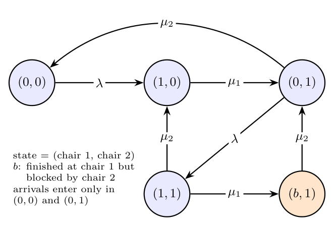

**(i) State space.** Counting customers is not enough: we must know which chair each customer occupies and whether a customer who has finished at chair 1 is stuck there. Use five states:

| State | Meaning |
|:-:|:--|
| $(0,0)$ | system empty |
| $(1,0)$ | one customer, in chair 1 |
| $(0,1)$ | one customer, in chair 2 |
| $(1,1)$ | two customers, both being served |
| $(b,1)$ | two customers; the one in chair 1 is finished but blocked, waiting for chair 2 |

A potential customer enters only when chair 1 is empty, i.e. in states $(0,0)$ and $(0,1)$.

**(ii) State transition diagram.**

| From | To | Rate | Event |
|:-:|:-:|:-:|:--|
| $(0,0)$ | $(1,0)$ | $\lambda$ | arrival enters chair 1 |
| $(1,0)$ | $(0,1)$ | $\mu_1$ | chair 1 done, moves to the free chair 2 |
| $(0,1)$ | $(1,1)$ | $\lambda$ | arrival enters chair 1 |
| $(0,1)$ | $(0,0)$ | $\mu_2$ | chair 2 done, leaves |
| $(1,1)$ | $(b,1)$ | $\mu_1$ | chair 1 done, chair 2 still busy: blocked |
| $(1,1)$ | $(1,0)$ | $\mu_2$ | chair 2 done, leaves |
| $(b,1)$ | $(0,1)$ | $\mu_2$ | chair 2 done; the blocked customer moves to chair 2 |

Arrivals in states $(1,0)$, $(1,1)$ and $(b,1)$ are blocked, so they cause no transition, and the only way out of $(b,1)$ is a chair-2 completion.

For later use, the diagram gives the balance equations (rate out = rate in): $\lambda P_{00}=\mu_2P_{01}$, $\mu_1P_{10}=\lambda P_{00}+\mu_2P_{11}$, $(\lambda+\mu_2)P_{01}=\mu_1P_{10}+\mu_2P_{b1}$, $(\mu_1+\mu_2)P_{11}=\lambda P_{01}$, $\mu_2P_{b1}=\mu_1P_{11}$, with the probabilities summing to 1.
