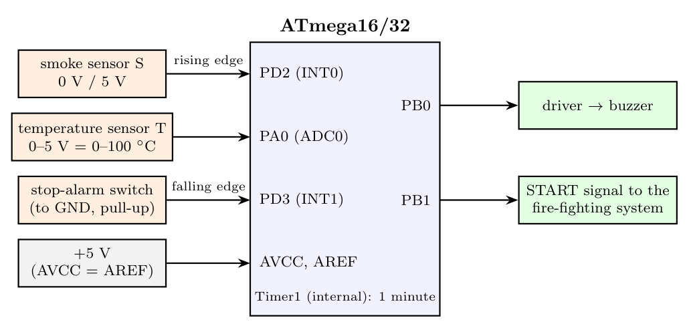
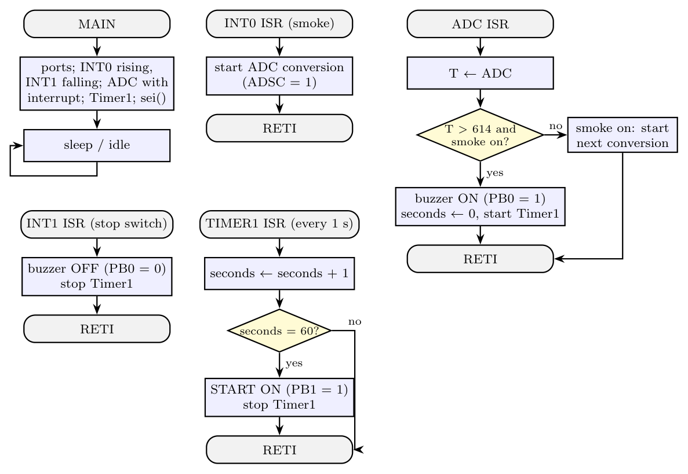

**(i) Block diagram**

- **S** is digital, so it goes to **INT0** (rising edge = smoke detected): no polling.
- **T** is analog, so it goes to **ADC0**; the conversion is started only after smoke is detected and finishes with an **ADC interrupt**. Threshold: 60 °C = $60/100 \times 5 = 3$ V, so $ADC = 3 \times 1024/5 = 614.4$; alarm if **ADC > 614**.
- **Stop switch** on **INT1** (falling edge).
- **Timer1** (e.g. 1 s CTC or overflow interrupt, counted to 60) measures 1 minute after the buzzer starts.
- **Buzzer** on **PB0**, **start signal** to the fire-fighting system on **PB1**.

**(ii) Flowchart**

*Assumptions:* 5 V reference, active-high buzzer driver and start input, a switch to ground with the internal pull-up for "stop".
