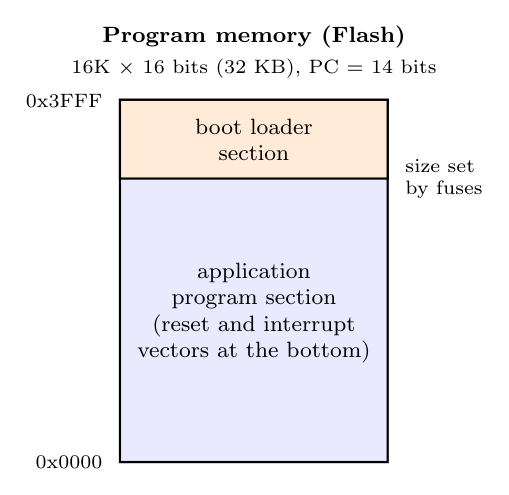
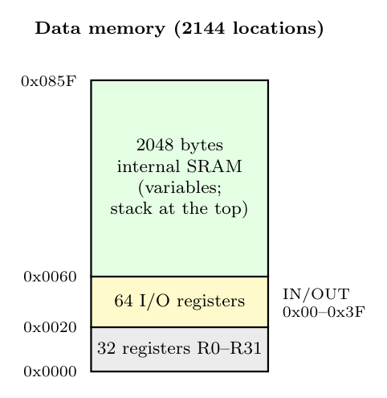

**Program memory map (Flash)**

- 32 KB of in-system reprogrammable Flash, organized as **16K $\times$ 16** (instructions are 16 or 32 bits), so the PC is 14 bits.
- Split into an **application section** (from 0x0000, starting with the reset and interrupt vectors) and a **boot loader section** at the top, which can reprogram the application section.

**Data memory map**

- 2144 locations in one linear space: registers, I/O registers and 2 KB SRAM, accessible with the LD/ST family (five addressing modes) and the I/O registers also with IN/OUT.
- The **EEPROM** (1 KB) is a separate data space accessed through EEAR, EEDR and EECR.
