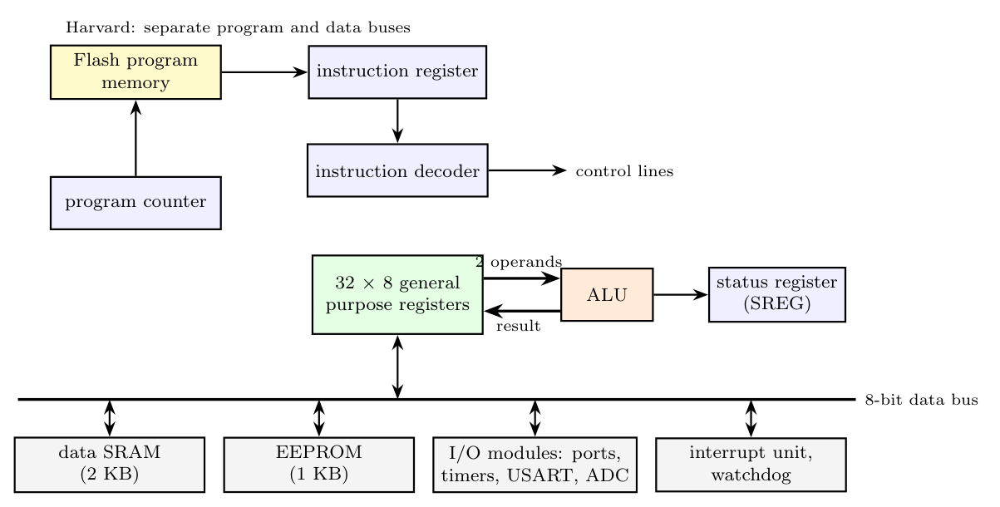

**Block diagram of the AVR CPU and memories**

**How it executes an instruction in (almost) every clock cycle**

1. **Harvard architecture:** program memory and data memory have separate buses, so an instruction can be fetched while data is being accessed.
2. **Single-level pipelining:** while one instruction is executing, the **next one is fetched** from Flash into the instruction register. When the current instruction finishes, the next is ready to execute at once.
3. **Register file + single-cycle ALU:** the 32 registers are all directly connected to the ALU. In **one clock** two register operands are read, the ALU performs the operation, and the result is written back to the register file (and SREG updated).
4. **Simple RISC instructions:** most are a single 16-bit word (one fetch) and execute in one cycle; only memory accesses, jumps and a few others take 2 or more cycles.

As a result the ATmega approaches **1 MIPS per MHz**.
