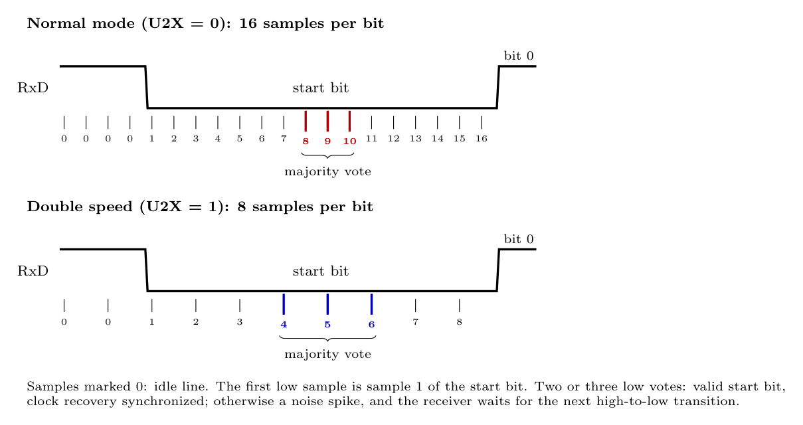

The clock recovery logic synchronizes the receiver's internal baud clock to each incoming frame by detecting the **start bit**.

1. **Oversampling.** RxD is sampled **16 times per bit in normal mode** and **8 times per bit in double-speed mode** (U2X = 1).
2. **Idle line.** While the line is idle (high), the samples are counted as "0" (no activity) and the logic waits for a **high-to-low transition**.
3. **Start-bit detection.** The first low sample starts the sequence; that sample is number 1 of the start bit.
4. **Majority vote in the middle of the bit:** normal mode uses **samples 8, 9 and 10**; double-speed mode uses **samples 4, 5 and 6**.
   - At least two of the three **low**: a **valid start bit**. The clock recovery is now synchronized, and data recovery samples each following bit in its centre.
   - Two or more **high**: the low level was a **noise spike**. The start bit is rejected and the receiver waits for the next high-to-low transition.
5. The process is repeated for **every frame**, so small baud-rate differences do not accumulate.

In double-speed mode there are half as many samples, so the receiver tolerates less baud-rate error and noise.
