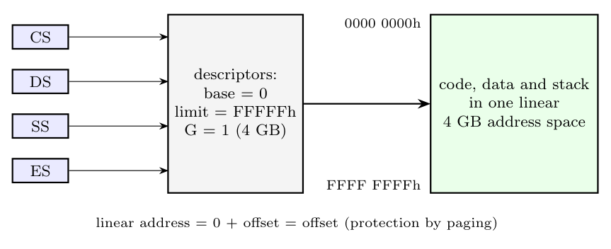

**Flat mode memory system.** The 80386 cannot switch segmentation off, but it can make it transparent:

- All segment descriptors used by a program (code, data, stack) are given **base = 00000000h** and **limit = FFFFFh with G = 1**, i.e. the full **4 GB**.
- Then CS, DS, ES, SS, ... all describe the same 4 GB region starting at 0, and

$$\text{linear address} = 0 + \text{offset} = \text{offset}$$

- The program sees **one linear, unsegmented address space** of 4 GB, addressed by 32-bit offsets (pointers). Segment registers are loaded once by the OS and never changed by programs.

**Advantages:** simple programming (no segment arithmetic, near 32-bit pointers everywhere), compilers and OSs are portable to other flat-memory CPUs, and no segment-register loads (faster).

**Protection and virtual memory** are provided by **paging** instead (per-page present, read/write, user/supervisor bits). Usually two pairs of flat segments are defined, DPL 0 for the kernel and DPL 3 for user programs. This is how Windows NT/XP and later, and Linux use the x86; in 64-bit mode segmentation is almost entirely flat by design.
