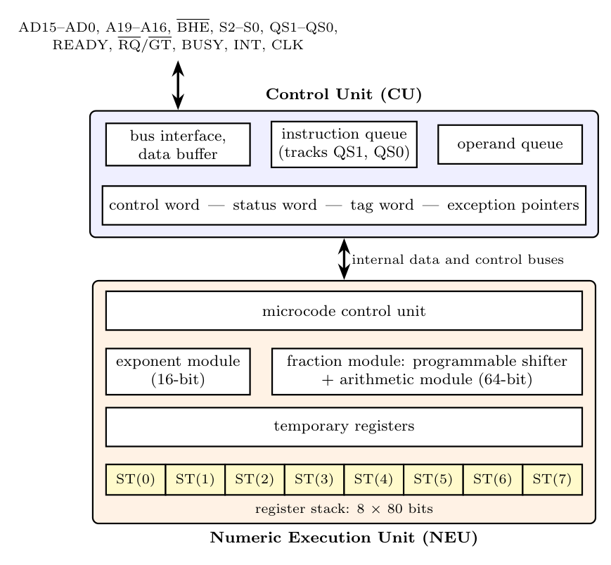

**Control Unit (CU):** connects the 8087 to the 8086's buses. It monitors the instruction stream (keeping a queue identical to the 8086's using QS0/QS1), recognizes ESC (floating-point) instructions, fetches memory operands through the data buffer and operand queue, and holds the **control word** (rounding, precision, exception masks), **status word** (condition codes, stack top pointer, exception flags), **tag word** (state of each stack register) and **exception pointers**. It signals BUSY (to the 8086's TEST pin) and INT on unmasked exceptions.

**Numeric Execution Unit (NEU):** performs all arithmetic in the 80-bit extended format, using the **8 $\times$ 80-bit register stack** (ST(0) top of stack), an **exponent module**, a **fraction module** with a **programmable shifter** and **arithmetic module**, and temporary registers, under **microcode** control.
