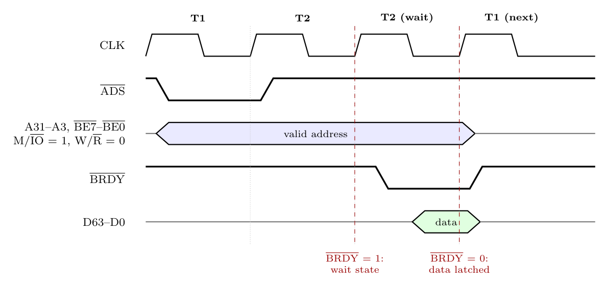

1. **T1:** the Pentium drives the address **A31-A3** and byte enables **$\overline{BE7}$-$\overline{BE0}$**, M/$\overline{IO}$ = 1 (memory) and **W/$\overline{R}$ = 0** (read), and pulses **$\overline{ADS}$** (address status) low for one clock to say a new valid bus cycle has started.
2. **T2:** the memory system works; the Pentium samples **$\overline{BRDY}$** (burst ready) at the **end of each T2**. If $\overline{BRDY}$ is high, another T2 (a wait state) follows.
3. When $\overline{BRDY}$ is low at the end of T2, the Pentium **latches the data from D63-D0** and the cycle ends. The next cycle can start with a new T1.

A non-pipelined read takes at least **2 clocks** (T1 + T2); the figure shows one wait state. (In pipelined mode, $\overline{NA}$ lets the next address be sent before the current data arrives.)
