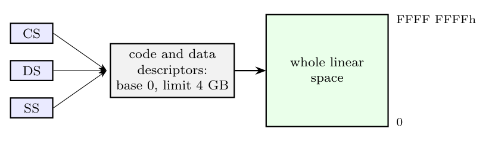
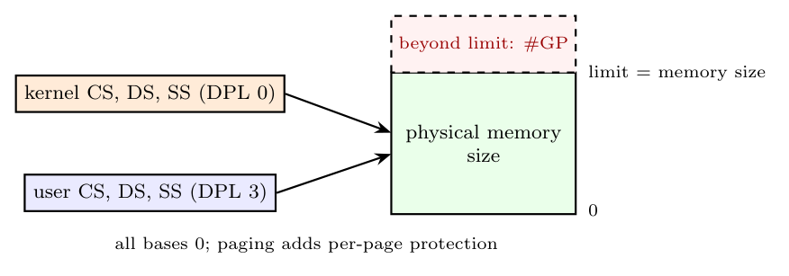
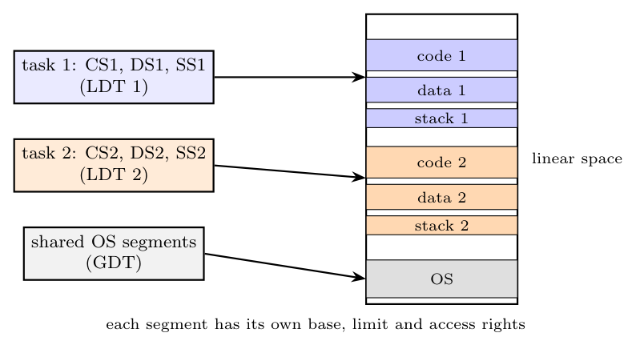

The Pentium always uses segmentation in protected mode, but the operating system can choose how much of it to use:

**1. Basic flat model**

The OS defines just **one code and one data segment**, both with **base 0 and limit 4 GB**. All segment registers point to them, so linear address = offset: the program sees a single flat 4 GB space. Segmentation is effectively switched off (no protection from it).

**2. Protected flat model**

Like the flat model, but the **limits are set to the actual memory size**, so an access beyond existing memory causes a general protection fault, and **separate code/data segments for user (PL 3) and supervisor (PL 0)** give two privilege levels. Usually combined with **paging** for per-page protection (this is how Windows and Linux use the Pentium).

**3. Multi-segment model**

Each program or task has **its own code, data and stack segments** (with their own bases, limits and access rights in the GDT/LDT). This uses the **full segment protection**: limit checks per segment, read-only/execute-only segments, privilege levels and separate address spaces per task.

In all three models **paging** can be enabled underneath to map the linear addresses to physical memory and provide virtual memory.
