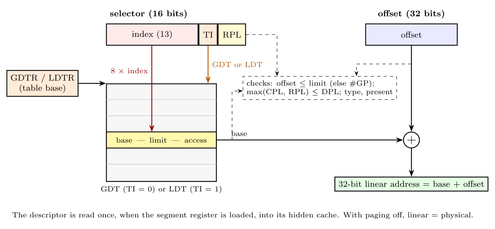
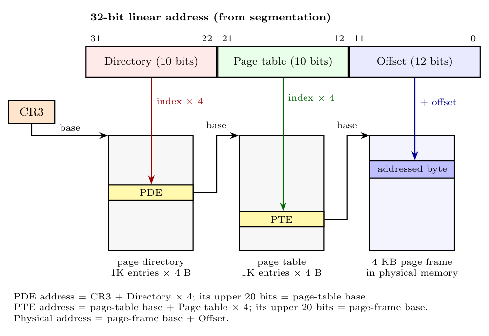
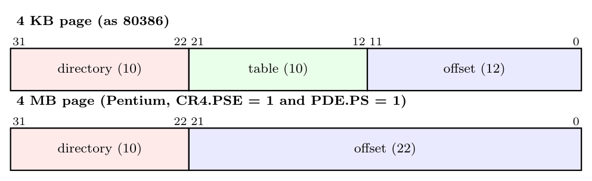

**Stage 1: segmentation (logical $\to$ linear)**

1. The selector's index and TI choose a descriptor in the GDT or LDT; its base, limit and access rights are loaded into the segment register's descriptor cache when the selector is loaded.
2. The processor checks the access (present, type, privilege, offset $\le$ limit; violation: exception 13 or 12).
3. **Linear address = base + offset.**

**Stage 2: paging (linear $\to$ physical), PG = 1**

1. The **TLB** is checked first (separate code and data TLBs for 4 KB and 4 MB pages). On a hit the frame address is taken directly.
2. On a miss, the PDE is read at CR3 + 4 $\times$ (bits 31-22). For a 4 KB page it gives a page table base, and the PTE at base + 4 $\times$ (bits 21-12) gives the page frame; for a 4 MB page the PDE gives the frame directly.
3. Present, R/W and U/S bits are checked; on a failure a **page fault (exception 14)** is raised with the linear address in **CR2**.
4. **Physical address = frame + offset**, driven onto the address bus.

*Example (80386 slides):* CS = 0018H, EIP = 10A2BC23H: GDT descriptor 3 gives base 3823A216H, so the linear address is 48C65E39H; directory 291, table 101, offset E39H; with the PTE giving frame 30000000H, the physical address is 30000E39H.
