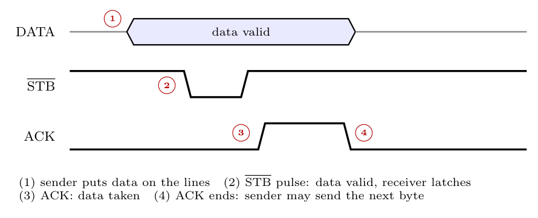
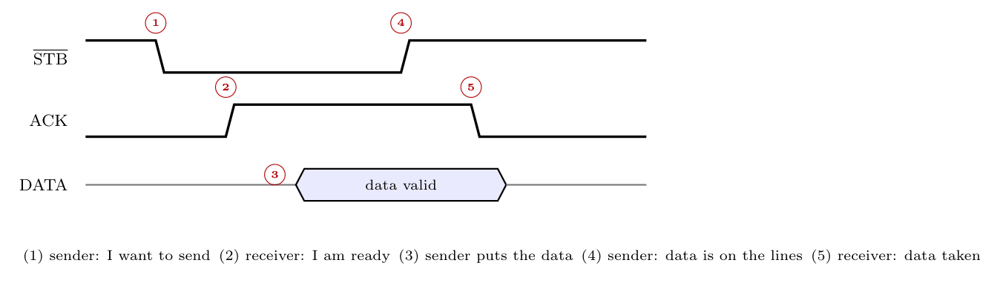

**(i) Single handshake I/O**

1. The sender puts a byte on the data lines.
2. It pulses $\overline{STB}$ low to tell the receiver that valid data is present; the receiver latches the data.
3. The receiver answers with an **ACK** pulse, meaning "I have taken the data".
4. When ACK ends the sender may send the next byte.

The sender knows each byte was received, so a slow receiver (e.g. a printer) does not lose data. Used by the 8255 in mode 1.

**(ii) Double handshake I/O**

1. The sender lowers $\overline{STB}$: "I have data, are you ready?"
2. The receiver raises **ACK**: "I am ready."
3. The sender puts the byte on the data lines.
4. The sender raises $\overline{STB}$: "Data is valid, take it." The receiver latches the data.
5. The receiver lowers **ACK**: "Data received." Only now may the sender remove the data and start the next transfer.

Each side confirms every step, so the transfer is reliable even between devices of very different speeds, at the cost of more control steps.
