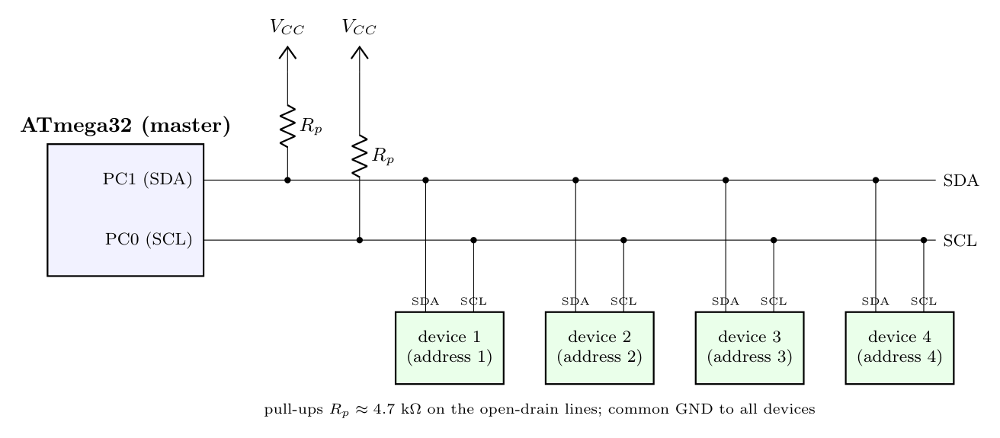

**(i) Protocol.** **TWI (Two-wire Serial Interface, Atmel's version of I2C).** It needs only **two wires** for any number of devices: **SDA** (serial data) and **SCL** (serial clock). UART would need a separate link per device, and SPI needs MOSI, MISO, SCK plus one select line per device.

**(ii) Preconditions**

1. All four devices must have a **TWI/I2C interface**.
2. Each device must have a **unique 7-bit address** on the bus (at most 128 addresses); the master selects a device by sending its address.
3. SDA and SCL are **open-drain/open-collector** lines, so each needs one **pull-up resistor** to Vcc (e.g. 4.7 k$\Omega$).
4. All devices share a **common ground** and compatible logic voltage levels, and they must support the chosen bit rate (e.g. 100 kHz or 400 kHz).
5. The bus must be short enough that its capacitance stays within the limit (400 pF).

**(iii) Connections**

The ATmega32 (master) drives SCL and addresses each device in turn over the same two wires.
