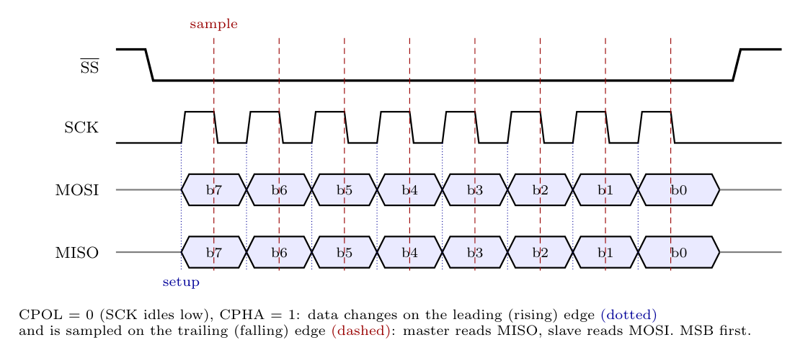

**SPI mode 1** (CPOL = 0, CPHA = 1): SCK is **low when idle**; the **leading (rising) edge is the setup edge** and the **trailing (falling) edge is the sample edge**.

**Sequence**

1. The master pulls SS' low; SCK is low (idle).
2. **Rising edge** of each pulse: master and slave shift the next bit onto MOSI and MISO (setup). The first bit (b7, MSB first) appears at the first rising edge.
3. **Falling edge**: the master samples MISO and the slave samples MOSI, in the middle of the bit's valid time.
4. After 8 pulses SCK stays low, the bytes are exchanged and SPIF is set; the master raises SS'.
