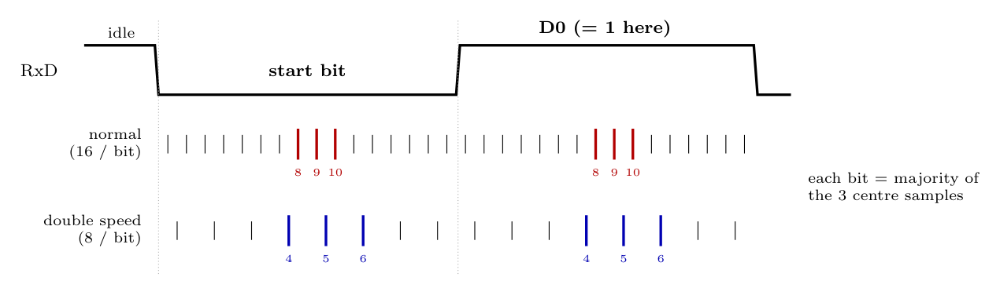

**Start bit (clock recovery)**

1. The receiver samples RxD at **16 $\times$ baud rate** in normal mode (**8 $\times$** in double-speed mode, U2X = 1). While the line is idle (high) it waits for a **high-to-low** transition.
2. On that edge the start-bit detection begins. In normal mode the receiver checks samples **8, 9 and 10** (the middle of the bit); in double-speed mode samples **4, 5 and 6**.
3. If at least two of the three are **low** (majority), the start bit is valid and the receiver's bit timing is synchronized to it. If two or more are high, the low pulse was noise and the receiver waits for the next falling edge.

**Data bits (data recovery)**

Each following bit (data, parity, stop) is also sampled 16 (or 8) times, and its value is the **majority vote of the three centre samples** (8, 9, 10 in normal, 4, 5, 6 in double speed). A 0 stop bit sets FE.

**Key difference.** Double-speed mode takes **half as many samples per bit (8 instead of 16)**. Each sample covers twice as much of the bit, so the start edge is located less precisely and the majority vote is taken over a wider part of the bit; the receiver therefore tolerates **less baud-rate mismatch and noise**: a more accurate baud rate and clock are needed. (For the transmitter there is no disadvantage.)
