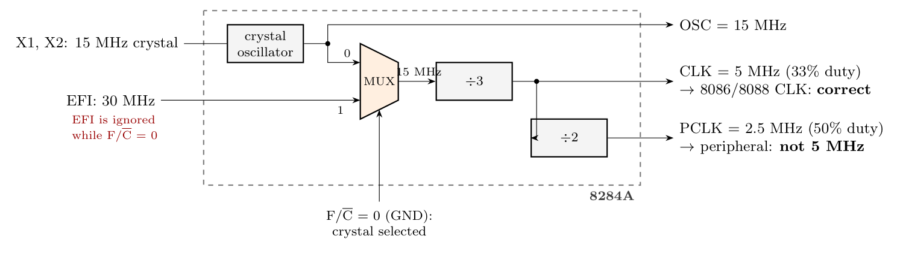

**How the 8284A produces its clocks**

F/$\overline{C}$ selects the source: **0 = crystal**, 1 = EFI. In the figure **F/$\overline{C}$ (and CSYNC) are grounded**, so the **15 MHz crystal** is used and the **30 MHz on EFI is ignored**.

**(i) Microprocessor: yes, it gets 5 MHz**

$$f_{CLK} = \frac{15\ \text{MHz}}{3} = \mathbf{5\ MHz}\ (33\%\ \text{duty cycle})$$

The crystal oscillator runs at 15 MHz, the multiplexer passes it (F/$\overline{C}$ = 0), the divide-by-3 counter gives 5 MHz on CLK, and CLK drives the CLK input of the 8086/8088. This is the standard 5 MHz connection.

**(ii) Peripheral: no, it does not get 5 MHz**

The 8284A's clock for peripherals is **PCLK**:

$$f_{PCLK} = \frac{f_{CLK}}{2} = \frac{5\ \text{MHz}}{2} = \mathbf{2.5\ MHz} \neq 5\ \text{MHz}$$

- The 30 MHz on EFI does not help, because it is not selected. Even with F/$\overline{C}$ = 1 it would give CLK = 10 MHz (too fast for a standard 8086/8088) and PCLK = 5 MHz, so the two requirements cannot both be met with one 8284A setting.
- The other outputs are OSC = 15 MHz and CLK = 5 MHz.

**Possible fixes:** clock the peripheral from **CLK** (5 MHz) if it accepts a 33% duty cycle, or take **OSC** (15 MHz) and divide it by 3 with an external counter to get a separate 5 MHz clock for the peripheral.
