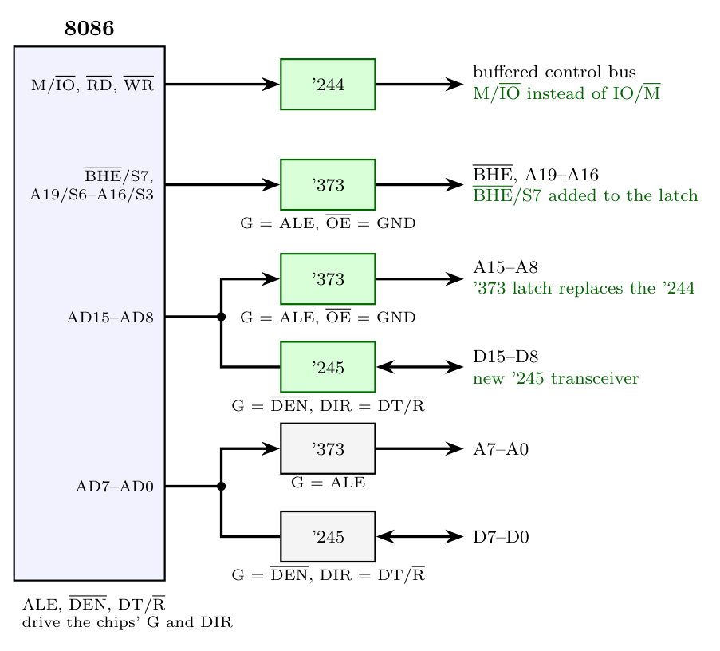

**Verdict: the circuit is not appropriate for a fully buffered 8086.** It is the fully buffered **8088** circuit. What is right: the A19/S6-A16/S3 '373 latch (G = ALE), the AD7-AD0 '373 latch (G = ALE) for A7-A0, the AD7-AD0 '245 transceiver (G = $\overline{DEN}$, DIR = DT/$\overline{R}$) for D7-D0, and the '244 for the control bus.

**Problems for the 8086**

1. **A15-A8 are buffered with a '244.** On the 8088 pins A15-A8 carry only address, but on the **8086 they are AD15-AD8**: address in T1, data in T2-T4. A '244 would pass the data onto the address bus in the middle of the cycle.
2. **No upper data bus.** The 8086 has a 16-bit data bus, but only D7-D0 are buffered, so D15-D8 (odd bytes, upper half of words) are missing.
3. **$\overline{BHE}$/S7 is missing.** The 8086 needs $\overline{BHE}$ to select the odd memory bank. It is multiplexed with status S7, so it must be latched.
4. **IO/$\overline{M}$ is an 8088 signal.** The 8086 provides **M/$\overline{IO}$** (opposite polarity) on pin 28.

**Corrections**

The fully buffered 8086 thus has **three '373 latches**, **two '245 transceivers** and one '244.
