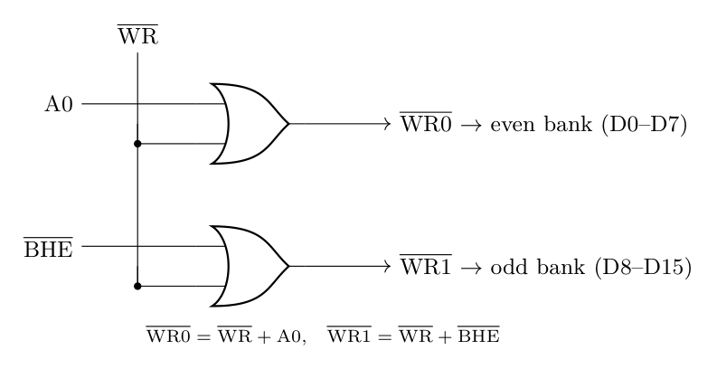
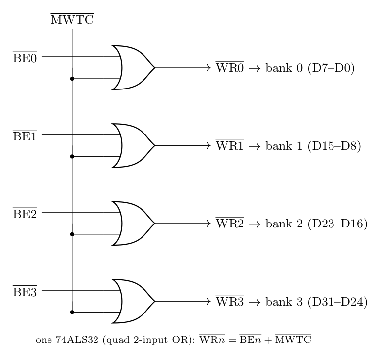

With separate write strobes, one decoder selects all banks for a read, and each bank gets its own **low-enabled write strobe**. A bank is written only when the write signal **and** its bank select are both low. For active-low signals, "both low" is an **OR** gate.

**8086 (two banks, selected by A0 and $\overline{BHE}$)**

$$\overline{WR0} = \overline{WR} + A0 \quad (\text{low/even bank, D0-D7})$$

$$\overline{WR1} = \overline{WR} + \overline{BHE} \quad (\text{high/odd bank, D8-D15})$$

| $\overline{WR}$ | $\overline{BHE}$ | A0 | $\overline{WR1}$ | $\overline{WR0}$ | Write |
|:-:|:-:|:-:|:-:|:-:|:--|
| 0 | 0 | 0 | 0 | 0 | word (both banks) |
| 0 | 0 | 1 | 0 | 1 | odd byte |
| 0 | 1 | 0 | 1 | 0 | even byte |
| 1 | x | x | 1 | 1 | no write |

(In maximum mode use $\overline{MWTC}$ in place of $\overline{WR}$.)

**80486 (four banks, selected by $\overline{BE3}$-$\overline{BE0}$)**

$$\overline{WR_n} = \overline{MWTC} + \overline{BE_n}, \qquad n = 0, 1, 2, 3$$

$\overline{WR_n}$ is low only when $\overline{MWTC}$ = 0 and $\overline{BE_n}$ = 0, so only the bytes being written are changed; a read enables all banks with the common $\overline{MRDC}$.
