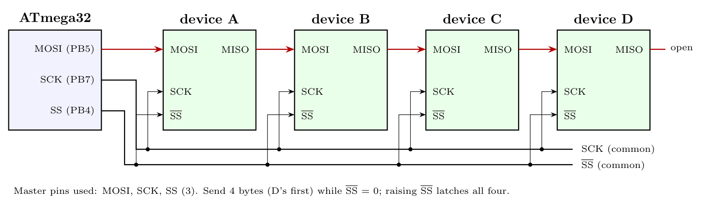

Since data only goes **from** the ATmega32 **to** the devices, the fewest master pins are used by a **daisy chain**: the slaves' shift registers are connected in series, and all share SCK and one slave-select line.

**Connections**

- ATmega32 **MOSI (PB5)** $\to$ MOSI of A; MISO of A $\to$ MOSI of B; MISO of B $\to$ MOSI of C; MISO of C $\to$ MOSI of D. (D's MISO is left open: nothing is read back.)
- ATmega32 **SCK (PB7)** $\to$ SCK of A, B, C, D.
- ATmega32 **SS (PB4, set as output)** $\to$ SS' of A, B, C, D.

**Pins used: 3** (MOSI, SCK, SS). MISO (PB6) is not needed because nothing is received.

**Sending:** pull SS' low, send **4 bytes** (the byte for D first, then C, B, A); after 32 clocks each byte has shifted into its device. Then raise SS' so all devices latch their data at once.

*Note:* this assumes the devices support daisy-chaining (shift data through MISO). If they do not, use the standard bus: MOSI and SCK shared, with each device's SS' driven by a **2-to-4 decoder** controlled by 2 port pins, which needs **4 pins** (instead of 6 with one SS pin per device).
