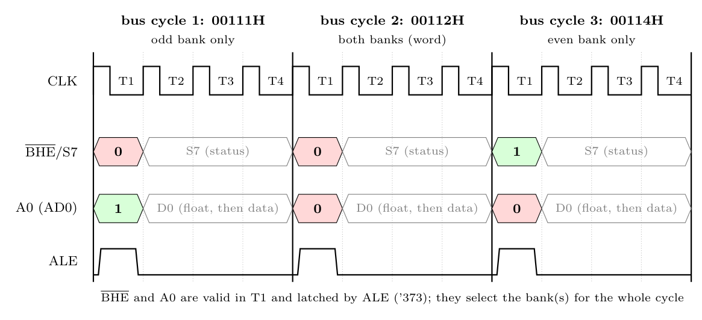

**Minimum number of clocks**

Locations 00111H, 00112H, 00113H, 00114H (4 bytes). Two bytes move together only as an **aligned word** (even address + next odd address).

| Bus cycle | Address | Bytes | $\overline{BHE}$ | A0 | Bank(s) | Data lines |
|:-:|:-:|:--|:-:|:-:|:--|:-:|
| 1 | 00111H | 00111H (odd) | 0 | 1 | odd only | D8-D15 |
| 2 | 00112H | 00112H, 00113H (aligned word) | 0 | 0 | both | D0-D15 |
| 3 | 00114H | 00114H (even) | 1 | 0 | even only | D0-D7 |

The first byte is odd and the last is even, so neither can pair inside the range: **3 bus cycles** minimum. Each bus cycle is 4 clocks (T1-T4), so with no wait states:

$$3 \times 4 = \mathbf{12\ clock\ cycles}$$

**$\overline{BHE}$ and A0 timing** (both are output in T1 of each bus cycle and latched by ALE)

*Note:* "clock" is read as clock period (T-state); the answer in bus cycles is 3.
