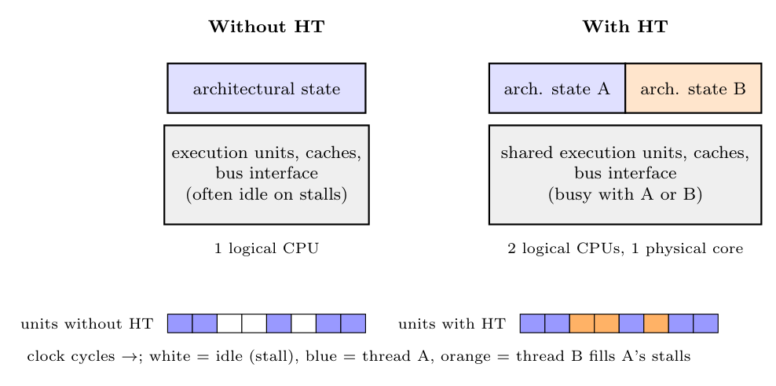

**Hyper-Threading (HT)**, introduced with the Pentium 4, makes **one physical processor core appear as two logical processors** to the operating system.

- The core holds **two copies of the architectural state**: general registers, segment and control registers, instruction pointer, flags and local APIC. Each copy runs one thread.
- Both threads **share** the expensive parts: caches, instruction decoders, out-of-order engine and **execution units** (ALUs, FPU, load/store).
- In one clock, micro-operations from **both** threads can be issued to the shared execution units. When one thread stalls (cache miss, branch misprediction, dependency), the other thread keeps the units busy.

Benefit: better use of the execution resources and higher throughput for multithreaded programs (about 15-30%) for only about 5% more chip area. It is not as fast as two real cores, because the threads compete for the same units.
