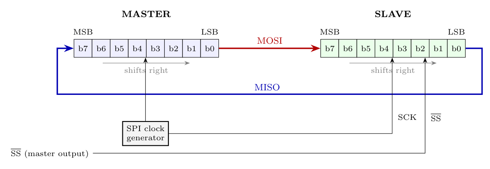

**Not compatible.**

In Figure 7(b), MOSI leaves the **master's MSB end** and enters the **slave's LSB end**, and MISO leaves the **slave's MSB end** and enters the **master's LSB end**. Each register shifts **left**: the MSB goes out first and the incoming bit fills the LSB. That is the **MSB-first** arrangement (DORD = 0), the same as the data-sheet figure.

With **DORD = 1 (LSB first)** the LSB must leave first, so the registers must shift **right**: the bit leaves from the **LSB end** and the received bit enters at the **MSB end**.

**Correct connection for LSB first**

- **MOSI:** master **LSB** out $\to$ slave **MSB** in.
- **MISO:** slave **LSB** out $\to$ master **MSB** in.

After 8 clocks the bytes are exchanged as before, but bit 0 travels first. (In the real ATmega32 the DORD bit changes the internal shift direction; the pins MOSI/MISO/SCK are wired the same way.)
