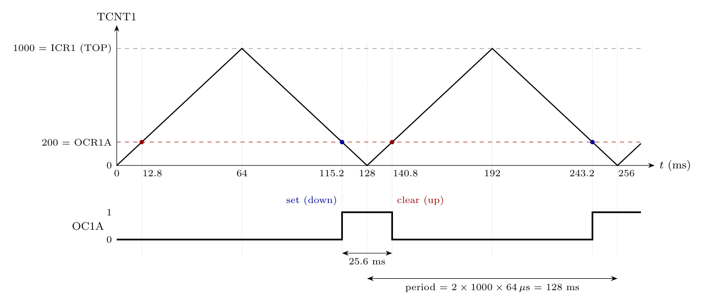

*Note:* the register is printed as OCR1B with an "A" written over the B. Since the output asked about is OC1A, the value is taken as **OCR1A = 200**. Clock 1 MHz (paper default).

**Mode.** WGM = 1010 is **phase correct PWM with TOP = ICR1 = 1000**: TCNT1 counts 0 $\to$ 1000 $\to$ 0. Tick = $64/1\,\text{MHz} = 64\ \mu s$.

**Frequency.** One period is $2 \times TOP$ ticks:

$$T = 2 \times 1000 \times 64\ \mu s = 128\ \text{ms}, \qquad f_{OC1A} = \frac{f_{clk}}{2\,N\,TOP} = \frac{10^6}{2 \times 64 \times 1000} = \mathbf{7.8125\ Hz}$$

**Duty cycle.** OC1A is cleared at the up-count match and set at the down-count match, so it is **high while TCNT1 < 200** (around BOTTOM):

$$t_{high} = 2 \times 200 \times 64\ \mu s = 25.6\ \text{ms}, \qquad D = \frac{OCR1A}{ICR1} = \frac{200}{1000} = \mathbf{20\%}$$

OC1A is 0 after reset, so the first up-count match (12.8 ms) leaves it at 0 and the first high pulse starts at the down-count match at 115.2 ms. From then on it is high for 25.6 ms around every BOTTOM (128 ms, 256 ms, ...).

(If OCR1B = 200 were meant literally, OCR1A would be unknown and OC1A's duty could not be found; OCR1B only affects OC1B.)
