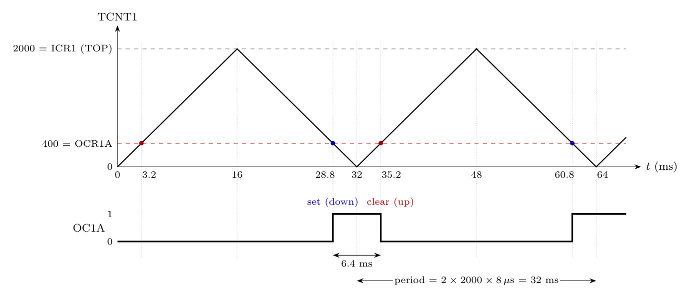

**Setup.** WGM = 1010 is **phase correct PWM with TOP = ICR1 = 2000**. TCNT1 counts up 0 $\to$ 2000 and then down 2000 $\to$ 0 (dual slope).

Assumption: system clock 1 MHz (paper default). With prescaler 8 the timer ticks every

$$t_{tick} = \frac{8}{1\ \text{MHz}} = 8\ \mu s$$

**Waveform.** OC1A is **cleared** on compare match while counting **up** and **set** on compare match while counting **down**. So OC1A is high while TCNT1 is below OCR1A = 400, around BOTTOM.

OC1A is 0 after reset, so the first up-count match at 3.2 ms leaves it at 0; the first high pulse starts at the down-count match at 28.8 ms.

OC1A goes **low** at the up-count match with 400 (t = 3.2 ms) and **high** again at the down-count match with 400 (t = 28.8 ms). It stays high through BOTTOM (t = 32 ms) until the next up-count match (t = 35.2 ms). The high pulse is centred on BOTTOM.

**Frequency**

One PWM period is a full up-down cycle of $2 \times TOP$ ticks:

$$T = 2 \times TOP \times t_{tick} = 2 \times 2000 \times 8\ \mu s = 32000\ \mu s = 32\ \text{ms}$$

$$f_{OC1A} = \frac{f_{clk}}{2\,N\,TOP} = \frac{10^6}{2 \times 8 \times 2000} = \mathbf{31.25\ Hz}$$

**Duty cycle**

High time = time TCNT1 spends below 400 = 400 ticks counting down + 400 ticks counting up:

$$t_{high} = 2 \times 400 \times 8\ \mu s = 6400\ \mu s = 6.4\ \text{ms}$$

$$D = \frac{t_{high}}{T} = \frac{6.4}{32} = \frac{OCR1A}{ICR1} = \frac{400}{2000} = \mathbf{20\%}$$
