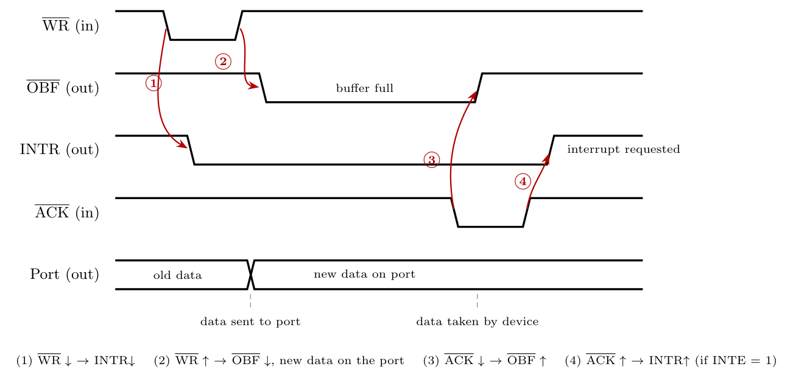

**i. Mode and application**

The signals $\overline{OBF}$ (output buffer full), $\overline{ACK}$ (acknowledge) and INTR belong to **8255 Mode 1 (strobed / handshake) output**.

*Applications:* sending data to a slower peripheral that must confirm each byte, such as a **printer** (the classic example), a plotter, or a display controller. The CPU writes a byte, the device takes it and acknowledges, and the 8255 interrupts the CPU for the next byte.

**ii. Inputs, outputs and cause $\to$ effect**

- **Inputs to the 8255:** $\overline{WR}$ (from the CPU, write to the port) and $\overline{ACK}$ (from the peripheral, "I have taken the data").
- **Outputs from the 8255:** $\overline{OBF}$ (to the peripheral, "new data is waiting"), **INTR** (to the CPU, "ready for the next byte"), and the **port data lines**.

| # | Input change | $\to$ | Output change |
|:-:|:--|:-:|:--|
| 1 | $\overline{WR}$ goes **low** (CPU starts writing) | $\to$ | **INTR goes low** (old request cleared) |
| 2 | $\overline{WR}$ goes **high** (end of write) | $\to$ | **$\overline{OBF}$ goes low** (buffer full) and the **new data appears on the port** |
| 3 | $\overline{ACK}$ goes **low** (device takes the data) | $\to$ | **$\overline{OBF}$ goes high** (buffer empty, data removed from port) |
| 4 | $\overline{ACK}$ goes **high** (end of acknowledge) | $\to$ | **INTR goes high** (interrupt requested, if INTE = 1) |

The arrows are: $\overline{WR}\downarrow \to$ INTR$\downarrow$; $\overline{WR}\uparrow \to \overline{OBF}\downarrow$ and data valid; $\overline{ACK}\downarrow \to \overline{OBF}\uparrow$; $\overline{ACK}\uparrow \to$ INTR$\uparrow$.
