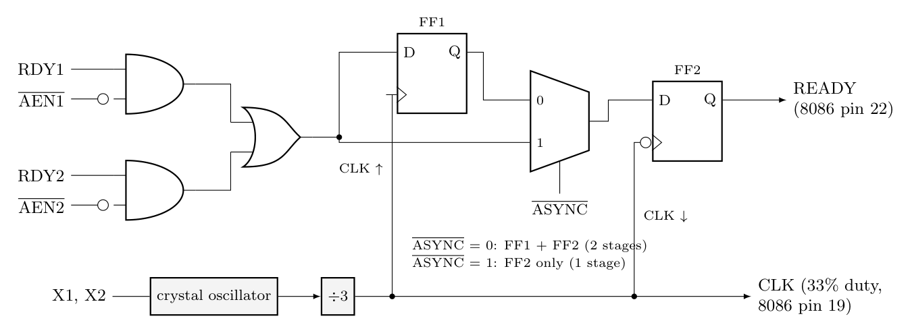

**Part of the 8284A block diagram used for READY**

**How READY is generated**

1. **Inputs from the system.** A slow memory or I/O device (through its wait-state logic) drives **RDY1** or **RDY2** high when it is ready. Each RDY input is valid only when its **address enable** ($\overline{AEN1}$ or $\overline{AEN2}$) is **low**, so two bus masters can each have their own ready line. The two gated signals are ORed.
2. **Synchronization.** The 8086 requires READY to meet set-up and hold times relative to CLK, but RDY from a device can change at any time. The 8284A therefore passes the ORed signal through flip-flops clocked by its own CLK:
   - $\overline{ASYNC}$ = **0**: **two stages** of synchronization (FF1 on the rising edge, FF2 on the falling edge of CLK). Used when RDY is **asynchronous** to CLK.
   - $\overline{ASYNC}$ = **1**: **one stage** (FF2 only). Used when RDY is already synchronous with CLK.
3. **Output.** The synchronized signal is the **READY** output to the 8086.
4. **Effect on the bus cycle.** The 8086 samples READY at the end of T2 (start of T3). If READY = 0, it inserts **wait states (Tw)** after T3 and keeps the address/control signals active. When READY returns to 1, the cycle continues with T4. This lets fast processors work with slow memory and I/O.

The same chip also generates the CLK (crystal oscillator divided by 3, 33% duty cycle) and a synchronized RESET from $\overline{RES}$ through a Schmitt trigger and flip-flop, which is why it is drawn as one block with READY.
