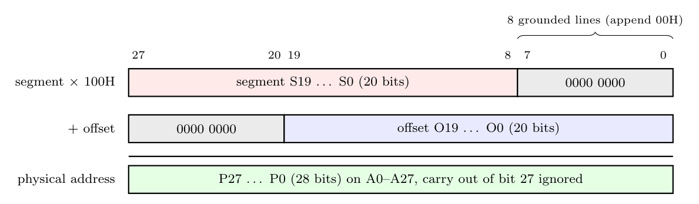

With the optimal paragraph of $2^{8}$ words from 1(a)(ii), the calculation is the 8086 method ("append 0H, then add"), with **8 zero bits (00H) appended instead of 4**:

1. Take the 20-bit segment value and **append 00H** to its right, i.e. shift left by 8 bits. This is pure wiring (the low 8 lines are grounded), so no multiplier and no shifter is needed.
2. **Add** the 20-bit offset (zero-extended) using a **28-bit adder** in the address unit.
3. The 28-bit sum is the physical (word) address placed on A0-A27. Any carry out of bit 27 is ignored, so the address wraps around.

**Example:** segment = 12345H, offset = 00ABCH:

$$1234500H + 0000ABCH = 1234FBCH$$

This is efficient: one 28-bit addition per access, every location can be reached, and segments can start on any 256-word boundary.
