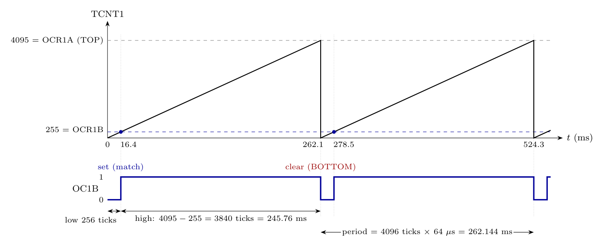

Assumption: system clock = 1 MHz (default, as in the slides; it is not given).

**Frequency** (slide 37):

$$F_{generated} = \frac{F_{oscillator}}{(TOP+1)\times N} = \frac{10^{6}}{(4095+1)\times64} = \frac{10^{6}}{262144} = \mathbf{3.81\ Hz}$$

(period = 262.1 ms)

**Duty cycle.** OC1B is *set on compare match and cleared at BOTTOM*: inverting mode, COM1B1:0 = 11. It is low from BOTTOM (0) to OCR1B and high from OCR1B to TOP. From slide 38:

$$\text{Duty} = \frac{TOP - OCR1B}{TOP+1}\times100 = \frac{4095-255}{4096}\times100 = \frac{3840}{4096}\times100 = \mathbf{93.75\%}$$

One tick is 64 $\mu$s. OC1B is low for the 256 ticks (16.384 ms) from BOTTOM to the OCR1B match and high for the remaining 3840 ticks (245.76 ms) up to TOP.

(For a 4 MHz clock the frequency would be 15.26 Hz; the duty cycle stays 93.75%.)
